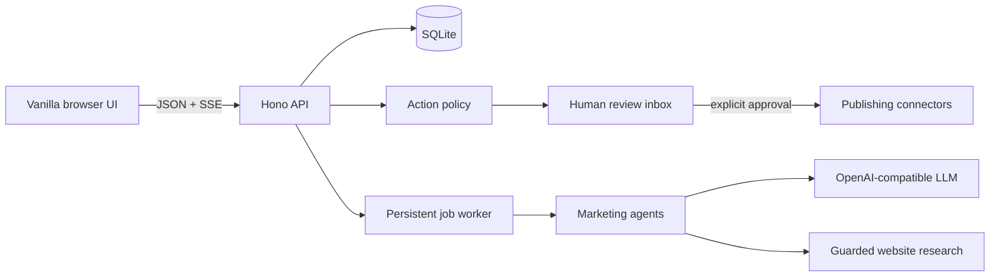

# OpenCMO

**A local-first marketing workspace that researches, plans, and drafts—while keeping every publication behind human approval.**

OpenCMO gives founders, freelancers, and small agencies one professional workspace for strategy, brand knowledge, multi-channel drafts, content planning, client reporting, and controlled publishing. It works with any OpenAI-compatible model and defaults to local [Ollama](https://ollama.com/); the app itself requires no cloud service.

| Plan | Create | Review | Deliver |
| --- | --- | --- | --- |
| Site health, strategy, competitors, Search Console opportunities | Eight focused agents, cited brand knowledge, 30-day plans | Quality checks, split inbox, approval rules, activity history | Calendar, connectors, and white-label offline reports |

## Quick start

With Docker:

```bash
docker compose up --build
```

Or install and open it with one command (Node.js 20+):

```bash
npx github:raym33/opencmo --port 3000 --data-dir ./data
```

For development from a clone:

```bash
cp .env.example .env
npm install
npm start
```

Open <http://127.0.0.1:3000>. For the default Ollama configuration, install Ollama and run:

```bash
ollama pull llama3.2
ollama serve
```

**Model quality matters.** In our SEO-audit test on a real site, a 3B model (`llama3.2:3b`) contradicted the measured findings and invented issues, while a 9B model (Qwen 3.5 9B) stuck to the evidence. Use a ~8B+ model for real work. Thinking models are called with `reasoning_effort: none` by default (override with `LLM_REASONING_EFFORT`) so they do not spend minutes reasoning.

Change `LLM_BASE_URL`, `LLM_API_KEY`, and `LLM_MODEL` in `.env` to use another compatible provider. `LLM_TIMEOUT_MS` controls each individual LLM call and defaults to 300000 (five minutes); a long monthly job is not subject to one global timeout. `LLM_MAX_CONCURRENCY` defaults to 1 so local-model calls are serialized. Project data is stored in `data/opencmo.sqlite`. Markdown publications go to `exports/` by default.

## What v0.7 includes

- A paid-product-quality responsive interface with a searchable project sidebar, breadcrumb header, light-first design, polished dark mode, accessible status colors, and consistent controls
- KPI-led Today dashboard, searchable split-view Inbox, month/week content calendar, safe formatted strategy documents, sectioned settings, and card/table agency views
- A dependency-free inline SVG icon system, logo, favicon, touch icon, reduced-motion support, loading skeletons, responsive navigation down to 360px, and design-system-aligned print styles
- Professional local repository documentation, contribution guidance, security reporting instructions, and issue/pull-request templates

All v0.6 reliability features remain available:

- Persistent SQLite-backed background jobs that resume after restart, serialize local-model calls by default, stream live progress through SSE, and support cancel/retry from the header
- Two-phase monthly plans: four compact weekly outline batches create 30 calendar placeholders, then short per-draft calls fill bodies while the user can already review the plan
- Robust JSON extraction/repair with one retry per weekly batch, title deduplication, partial-result preservation, and per-draft **Write this one now** priority
- Concise, structured strategies capped at about 450 words and streamed into the UI; first-run strategy work uses the same durable job system
- Rolling model-speed estimates and warnings for work likely to exceed five minutes, plus an optional fast model dedicated to draft bodies
- Approval, scheduling, and publishing guards that reject any draft whose body is not finished

All v0.5 agency features remain available:

- White-label, self-contained client reports with agency branding, executive summary, measured site findings, AI visibility, search opportunities, 30-day plan, next steps, and print-to-PDF CSS
- Search Console Queries CSV import in English or Spanish, ranked low-CTR opportunities, and one-click Writer drafts grounded in query context
- Deterministic side-by-side competitor checks for titles, descriptions, headings, structured data, Open Graph, and HTML size through the safe website fetcher
- A multi-project agency overview with health, approvals, the next scheduled post, and overdue work
- An English/Spanish GitHub Pages-ready landing site and launch checklist under `docs/`
- A `npx`-style command with port/data-folder options and browser opening, plus a macOS `start.command`
- A plain-language in-app trust and safety guide
- Wizard QA fixes for cloud form visibility, embedding-model filtering, small-model labels, consistent demo health, and demo sources

All v0.4 onboarding and daily-work features remain available:

- A resumable, three-step first-run wizard with local Ollama model detection, cloud presets, connection testing, guided site profiling, live analysis progress, a deterministic site-health score, strategy, and five ready-to-review starter drafts
- A project-level **Today** dashboard with health trend, three ranked next actions, pending approvals, the coming week's content, and the latest briefing
- **Generate my month**, which creates 30 multi-channel pending drafts spread across the calendar without publishing anything
- Draft sources, channel character limits enforced before approval, live counters, cliché detection, one-click cleanup, and regeneration with written feedback
- Complete English/Spanish navigation and product guidance, normalized-URL duplicate prevention with an explicit merge, friendly recovery actions, loading skeletons, reject undo, accessible focus styles, shortcut help, and responsive layouts
- A no-LLM sample business with canned strategy, drafts, knowledge, health, and AI-visibility history; sample data is clearly marked and removable
- Simplified Basic settings for the AI engine, language, and export folder, with connectors, backups, Telegram, Hindsight, retrieval, and rate controls under Advanced

All v0.3 knowledge, policy, observability, safe-fetching, briefing, backup, and memory features remain available.

- URL onboarding and an LLM-generated strategy covering positioning, ICP, keyword themes, competitors to investigate, and channels
- Writer, SEO, GEO, Reddit, X, LinkedIn, Newsletter, and HN/Product Hunt launch agents
- Deterministic SEO checks for title, description, H1s, links, image alt text, canonical URL, Open Graph and Twitter tags, HTML language, JSON-LD, up to 20 internal links, robots.txt, and sitemap.xml
- Reddit public JSON research with copy-only, human-reviewed reply drafts
- A draft inbox with editing and enforced `pending → approved → published` workflow (rejection and re-approval are supported)
- Markdown, WordPress REST, GitHub Contents API, generic webhook, Telegram, and Discord connectors
- A small JSON HTTP API and dependency-free browser UI
- Browser settings with masked credentials, streamed run progress, GEO score history, and English/Spanish project output
- An approved-content calendar with automatic due publishing, edit history, bulk review, shortcuts, dark mode, and mobile layouts
- SSRF protection, basic API rate limiting, Docker support, and Node 20/22 CI
- Per-project brand knowledge with Spanish-aware BM25 retrieval, optional OpenAI-compatible embeddings, reciprocal-rank fusion, quoted-data prompt boundaries, and citations
- A code-enforced action policy floor, approval queue, append-only activity log, and global agent kill switch
- Prompt-free LLM telemetry, an hourly call cap, guarded/robots-aware website profiling, daily read-only briefs, automatic and manual SQLite backups, startup integrity checks, and optional local Hindsight memory

GEO results are a directional sample from the configured model, not proof of visibility across commercial AI search products. Reddit replies are never posted automatically. The WordPress connector publishes posts immediately only after the corresponding OpenCMO draft has been approved.

## Configuration

Environment values are defaults; the main options can also be saved locally from Settings. Secrets returned to the browser are masked.

| Variable | Default | Purpose |
| --- | --- | --- |
| `HOST` | `127.0.0.1` | Bind address; keep local unless you add authentication |
| `PORT` | `3000` | HTTP port |
| `DATA_DIR` | `./data` | SQLite database and backups |
| `LLM_BASE_URL` | `http://localhost:11434/v1` | OpenAI-compatible API base URL |
| `LLM_API_KEY` | `ollama` | Provider credential |
| `LLM_MODEL` | `llama3.2` | Chat model |
| `LLM_TIMEOUT_MS` | `300000` | Timeout for each model call |
| `LLM_MAX_CONCURRENCY` | `1` | Concurrent model calls |
| `MARKDOWN_EXPORT_DIR` | `./exports` | Local Markdown publication folder |
| `ALLOW_PRIVATE_FETCH` | `0` | Opt in to trusted private-network website reads |

### Connector configuration

Markdown export is always available. Optional connectors appear disabled until all required variables are set:

| Connector | Variables |
| --- | --- |
| WordPress | `WP_URL`, `WP_USERNAME`, `WP_APP_PASSWORD` |
| GitHub | `GITHUB_TOKEN`, `GITHUB_REPO` (`owner/repository`), optional `GITHUB_BRANCH` |
| Webhook | `WEBHOOK_URL`, optional bearer `WEBHOOK_SECRET` |
| Telegram | `TELEGRAM_BOT_TOKEN`, `TELEGRAM_CHAT_ID` |
| Discord | `DISCORD_WEBHOOK_URL` |

GitHub writes Markdown into `content/`. WordPress uses an application password. The webhook receives `{ event, draft, project }` as JSON.

## API

API request and response bodies are JSON except the report download, which returns a self-contained HTML file.

```text
GET  /api/health
GET/PUT /api/settings
POST /api/settings/test-llm
GET  /api/engines/ollama
GET  /api/projects
GET  /api/overview
POST /api/projects
PATCH /api/projects/:id
POST /api/projects/:id/merge
DELETE /api/projects/:id                 (sample projects only)
GET  /api/projects/:id/dashboard
GET  /api/projects/:id/report
GET/POST /api/projects/:id/search-console
POST /api/projects/:id/search-console/:opportunityId/draft
POST /api/projects/:id/competitors/audit
POST /api/projects/:id/health
POST /api/projects/:id/strategy
POST /api/projects/:id/month-plan
GET  /api/projects/:id/estimate?kind=month-plan
POST /api/onboarding/run
POST /api/demo
GET  /api/agents
POST /api/projects/:id/agents/:agent/run  { "task": "..." }
GET  /api/drafts?project=&status=
PATCH /api/drafts/:id                    { "body": "..." }
POST /api/drafts/bulk
POST /api/drafts/:id/approve
POST /api/drafts/:id/reject
POST /api/drafts/:id/undo-reject
POST /api/drafts/:id/regenerate
POST /api/drafts/:id/write-now
POST /api/drafts/:id/schedule
POST /api/drafts/:id/publish             { "connector": "markdown" }
GET  /api/jobs?project=
GET  /api/jobs/stream                    (SSE)
POST /api/jobs/:id/cancel
POST /api/jobs/:id/retry
GET  /api/connectors
GET/POST /api/projects/:id/knowledge
POST /api/projects/:id/knowledge/import-site
GET/PUT /api/policy
POST /api/agents/stop
GET/POST /api/backups
```

Example:

```bash
curl -s http://127.0.0.1:3000/api/projects \
  -H 'content-type: application/json' \
  -d '{"name":"Acme","url":"https://example.com","audience":"small teams","tone":"practical"}'
```

## Architecture



The Hono app is assembled in `src/app.ts`; dependencies such as the LLM and `fetch` are injectable. `src/db.ts` owns the SQLite schema and draft state machine. Agent implementations live in `src/agents.ts`, deterministic web analysis in `src/web.ts`, and publisher adapters in `src/connectors.ts`.

### Security model

Agent-created side effects pass through one action-policy gate. The hard floor permanently prevents agents from publishing without approval, deleting or exporting data, changing settings or policy, and connecting channels. Retrieved knowledge and optional memory are explicitly delimited as untrusted data, never instructions. Website reads allow only HTTP(S), resolve and reject private addresses before every redirect, impose redirect/time/size limits, use a polite user agent, and honor robots.txt. Publishing still requires a human-approved draft.

The v0.3 design ports useful ideas from REM-L (MIT, same author), including its compact RAG, policy/review boundary, LLM metrics, safe web profiling, brief scheduler, backup lifecycle, and optional Hindsight boundary. The implementation is native to OpenCMO's TypeScript/Hono/SQLite architecture; invoicing, tax, and macOS-specific parts were intentionally excluded.

## Development

```bash
npm run dev
npm test
npx tsc --noEmit
```

Tests use Node's built-in test runner and an LLM stub; they do not need a model server.

Docker users can run `docker compose up --build`. To start the optional Ollama container too, use `docker compose --profile ollama up --build`, then point the app at `http://ollama:11434/v1`.

## Screenshots

> Screenshots placeholder — first-run wizard, Today dashboard, quality-aware inbox, content calendar, and simplified settings views will be added here.

## OpenCMO and okara.ai

| | OpenCMO | okara.ai |
| --- | --- | --- |
| License | MIT, source available | See vendor terms |
| Data location | Local SQLite by default | Hosted service |
| Model choice | Any OpenAI-compatible endpoint, including Ollama | Service-managed |
| Publishing safety | Explicit approval enforced in the state machine | See vendor documentation |
| Extensibility | TypeScript agents and connectors | Product integrations |

This table describes OpenCMO's design, not an independent feature audit of okara.ai. Vendor capabilities and pricing can change.

## Roadmap

- Webflow and Framer publishing
- Scheduled agent runs and approval reminders
- Richer crawl-based SEO audits and analytics integrations
- More connector-specific previews and publication history
- Encrypted-at-rest credential storage and multi-user authentication for network deployments

## FAQ

**Does OpenCMO publish automatically?**

No. A draft must pass the code-enforced approval state before it can be scheduled or published. Unfinished background drafts cannot be approved.

**Does my data leave the computer?**

Project data stays in local SQLite. Prompts go to the AI endpoint you configure, site checks contact the public URLs you request, and approved content goes only to the connector you choose.

**Do I need Ollama?**

No. Ollama is the private, local default; OpenAI-compatible hosted providers work too.

**Can I use this for clients?**

Yes. The agency overview, multiple projects, brand knowledge, and offline white-label reports are designed for freelancer and small-agency workflows.

**Is network deployment supported?**

The app is intended for local use and has no built-in user authentication. Add a trusted reverse proxy and authentication before exposing it to a network.

## Disclaimer

OpenCMO is not affiliated with, endorsed by, or sponsored by okara.ai. Review generated content and external-service permissions before publishing.

## License

MIT © OpenCMO contributors
