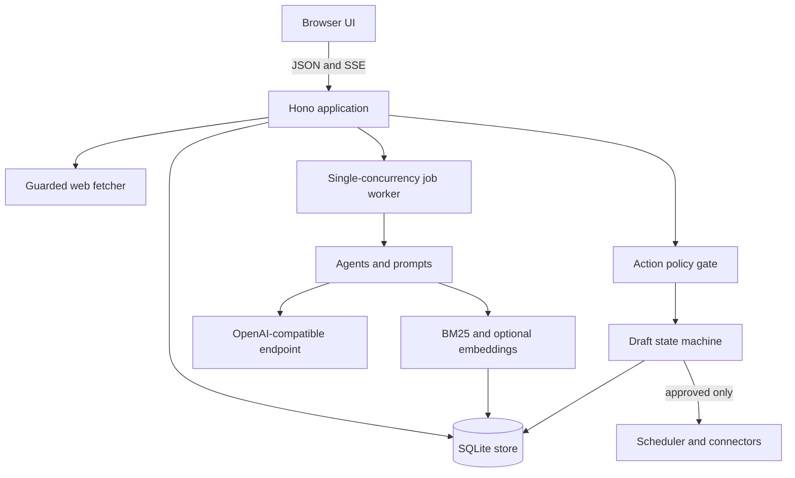

# OpenCMO architecture

OpenCMO is a single-process, local-first Node.js application. The browser interface is static HTML, CSS, and JavaScript; it talks to a Hono JSON/SSE API backed by SQLite. There is no frontend build step and no required hosted service.

## Boundaries

- `src/app.ts` composes HTTP routes, dependencies, background work, and maintenance.
- `src/db.ts` owns schema migrations, persistence, draft transitions, and job recovery.
- `src/jobs.ts` owns durable model workflows, cancellation, progress, parsing, and estimates.
- `src/agents.ts` defines agent capabilities and produces draft inputs; it does not publish.
- `src/policy.ts` applies the hard safety floor and configurable action modes.
- `src/web.ts` owns deterministic audits, website profiles, robots handling, and SSRF controls.
- `src/rag.ts` chunks, ranks, and formats project knowledge as untrusted quoted data.
- `src/connectors.ts` contains explicit publication adapters.
- `public/` is the dependency-free browser application and design system.

## Durable work

Model-heavy strategy and monthly-plan flows are stored as jobs. At startup, interrupted `running` jobs return to `queued`. The worker serializes calls by default, publishes progress through SSE, and keeps partial monthly-plan results if a later body fails.

## Safety invariants

Draft creation and other agent effects go through the action policy. Code-level floor actions cannot be relaxed by settings. Publication requires an `approved` draft with a completed body. Website reads validate protocols and resolved addresses on redirects, enforce time and size limits, and honor robots rules.

## Data ownership

Projects, settings, knowledge, jobs, drafts, and metrics live in the configured SQLite database. Automatic backups use SQLite `VACUUM INTO`. Secrets are masked over the API but are not encrypted at rest. External data transfer occurs only through the configured LLM, requested public-site reads, or a connector selected for an approved draft.
